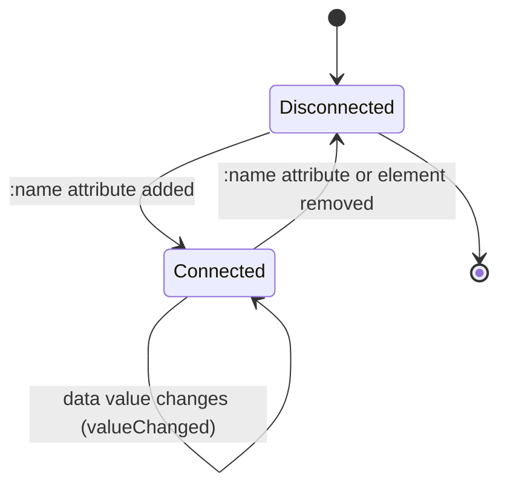

# Magnus

[](https://www.npmjs.com/package/@oscarpalmer/magnus)

A JavaScript framework for developers who like HTML.

Magnus reads attributes on HTML you already have and wires them to controllers, targets, actions, and data — without a build step, a virtual DOM, or a rendering model of its own. It solves the same problem as [Stimulus](https://github.com/hotwired/stimulus): adding interactive behavior to server-rendered or static HTML. It's considerably smaller, so if you need routing, component rendering, or a larger ecosystem, use Stimulus — or a bigger framework — instead.

## Core concepts

| Term               | Is                                                                                                  | Is not                                                                                |
| ------------------ | --------------------------------------------------------------------------------------------------- | ------------------------------------------------------------------------------------- |
| __Controller__     | A class that implements behavior for one named group of elements, found via the `:name` attribute   | A component that renders HTML                                                         |
| __Target__         | A named reference to element(s) inside a controller, found via `target:controller.name`             | Unique per name — one target name can match several elements                          |
| __Action__         | An event handler on an element, wired to a controller method via `on:`                              | Limited to one event or one controller per element                                    |
| __Input / output__ | Built-in targets that read from, or write to, a controller's data                                   | Symmetric — an output never writes back to data                                       |
| __Data__           | Flat, optionally typed state seeded from `controller-name`-prefixed attributes, then held in memory | A deep state-management system — nesting works, but Magnus doesn't help you manage it |

## Quick start

Start with some HTML:

```html
<div :talin>
  <input target:talin.input type="text" />

  <button on:click="talin.greet">Greet</button>

  <pre target:talin.output></pre>
</div>
```

...and a controller:

```typescript
import {Controller} from '@oscarpalmer/magnus';

export class Talin extends Controller {
  greet(): void {
    this.targets.get('output')!.textContent = (this.targets.get('input') as HTMLInputElement).value;
  }
}
```

Register the controller, and Magnus takes care of the rest — no explicit "scan the DOM" call required, because Magnus already watches it:

```typescript
import {magnus} from '@oscarpalmer/magnus';

magnus.add('talin', Talin);
```

Typing into the input and clicking the button copies the input's value into the `<pre>` element below it. Magnus made that connection by reading the `:talin`, `target:talin.input`, `target:talin.output`, and `on:click` attributes — no manual element lookups or event bindings in `Talin` itself.

_(Thanks to [Stimulus](https://github.com/hotwired/stimulus) for the example, which looks mostly the same for Magnus.)_

## Installation

Magnus is available on npm as `@oscarpalmer/magnus` and works with any JavaScript bundler, or standalone from the file in the `dist` folder.

## How Magnus works

### Lifecycle

Magnus is built on a [`MutationObserver`](https://developer.mozilla.org/en-US/docs/Web/API/MutationObserver): it watches the document for element and attribute changes and reacts to the ones it recognizes (`:name`, `target:`, `on:`, `input:`, `output:`, and typed data attributes).



Each recognized attribute change can:

- create (or remove) a controller instance;
- create (or remove) a target on a controller;
- create (or remove) an action — a controller-specific event handler;
- create (or remove) an input or output target — built-in targets with actions attached, for reactivity.

A controller's `connect` method runs once it has an element; `disconnect` runs once that connection ends — the element was removed, or its `:name` attribute was removed. (Changing an attribute's _value_ only matters for actions, where Magnus diffs the old and new `controller.method` list; see [Actions](#actions).) A controller may also implement `valueChanged(name, value)`, called whenever a value in its `data` changes.

### Starting and stopping

Importing `magnus` starts it immediately — it's already observing the document:

```typescript
import {magnus} from '@oscarpalmer/magnus';

magnus.active; // `true`: is Magnus currently observing the document?

magnus.stop();  // Stops observing. Existing controller instances are untouched.
magnus.start(); // Resumes observing from the current DOM state.
```

`start` and `stop` are idempotent: calling either while already in that state does nothing.

### Controllers

A Magnus controller is a class extending the base `Controller`:

```typescript
import {Controller} from '@oscarpalmer/magnus';

export class Talin extends Controller {}
```

Register it with a name — the same name used in the `:name` attribute, e.g. `:talin`:

```typescript
import {magnus} from '@oscarpalmer/magnus';
import {Talin} from './talin';

magnus.add('talin', Talin); // Watches for `:talin` from now on

magnus.remove('talin'); // Stops watching, and disconnects every existing instance
```

Removing an element's `:name` attribute — or removing the element itself — disconnects that instance: Magnus stops observing it, removes its actions and targets, and calls `disconnect`. Removing a target's, input's, or output's attribute individually detaches just that one piece, without affecting the rest of the controller. Actions behave slightly differently: changing an `on:` attribute's _value_ re-diffs the `controller.method` list, adding and removing only what changed.

#### Attach controllers programmatically

`setController` and `removeController` do exactly what setting or removing the `:name` attribute would:

```typescript
import {removeController, setController} from '@oscarpalmer/magnus';

setController(element, 'talin');    // Same as setting the `:talin` attribute
removeController(element, 'talin'); // Same as removing the `:talin` attribute
```

### Targets

A target is a named reference to one or more elements inside a controller, declared with `target:controller.name`.

`target:talin.output` resolves to the nearest `talin` controller's `output` target group. To target one specific instance instead of the nearest one, add its `id`: `target:talin.id.output`.

```html
<span target:talin.output></span>
```

```typescript
import {Controller} from '@oscarpalmer/magnus';

export class Talin extends Controller {
  getTargets(): void {
    this.targets.get('output');     // The first matching element, or `undefined`
    this.targets.getAll('output');  // Every matching element, as an array
    this.targets.has('output');     // `true` if at least one match exists
    this.targets.find('pre');       // The first descendant matching a selector — any selector `querySelectorAll` accepts, not just targets
  }
}
```

`get`, `getAll`, and `find` accept an optional type parameter for a properly typed result, e.g. `this.targets.find<HTMLButtonElement>('button')`. `has` does not, since it returns a plain boolean.

#### Attach targets programmatically

```typescript
import {removeTarget, setTarget} from '@oscarpalmer/magnus';

setTarget(element, 'talin', 'output');    // Same as setting the `target:talin.output` attribute
removeTarget(element, 'talin', 'output'); // Same as removing the `target:talin.output` attribute
```

### Actions

An action connects an event on an element to a controller method, declared with the `on:` attribute. It comes in two shapes:

- `on:controller.method` (no value) — Magnus infers the event from the element: `click` for `<a>`, `<button>`, and submit inputs; `input` for other `<input>` and `<textarea>` elements; `change` for `<select>`; `toggle` for `<details>`; `submit` for `<form>`.
- `on:event="controller.method"` (with a value) — listens for `event` explicitly.

Either form accepts a specific instance (`controller.id.method`), options, and multiple space-separated `controller.method` pairs, so more than one controller or method can react to the same event.

#### Action syntax

`on:[event=]"controller[.id].method[:options]"`

| Part         | Required | Description                                                                                                                                                       |
| ------------ | -------- | ----------------------------------------------------------------------------------------------------------------------------------------------------------------- |
| `controller` | yes      | Name of the controller to call                                                                                                                                    |
| `method`     | yes      | Name of the method to call. Must not be `connect`, `disconnect`, `constructor`, or start with `__` — Magnus silently skips wiring the action rather than erroring |
| `id`         | no       | Targets one specific controller instance instead of the nearest match                                                                                             |
| `event`      | no       | Event name. Omit it to use the element's inferred default                                                                                                         |
| `options`    | no       | Colon-separated event-listener options (see below)                                                                                                                |

Options, when present, are one or more of:

- `a` or `active` — allow `preventDefault` (by default, Magnus adds listeners as passive)
- `c` or `capture` — listen during the capture phase
- `o` or `once` — remove the listener after it fires once

```html
<button on:click="talin.greet:once">Greet</button>
```

```typescript
import {Controller} from '@oscarpalmer/magnus';

export class Talin extends Controller {
  greet(): void {
    // Called once, on the next click
  }
}
```

#### Listen outside the controller's element

Prefix the event with an external target — `window`, `document`, another controller, or an element `id` — to listen there instead:

```html
<div :talin on:window.resize="talin.onResize"></div>
```

An external controller can take an identifier too, e.g. `on:other.id.event="talin.method"`, to target one specific instance instead of the nearest match.

#### Dispatch and listen to events

Every controller has an `events` helper for dispatching its own events and managing listeners:

```typescript
import {Controller} from '@oscarpalmer/magnus';

export class Talin extends Controller {
  trigger(): void {
    this.events.dispatch('event');
    this.events.dispatch('event', target);
    this.events.dispatch('event', options, target);

    const off = this.events.on('event', callback);

    this.events.off('event', callback);
  }
}
```

`dispatch(type, target?)` fires `type` synchronously on the controller's element, or on `target` — a string resolves to the first matching target in the controller; otherwise any `EventTarget` (an element, `document`, or `window`). `dispatch(type, options, target?)` additionally accepts bubbling, cancellation, composition, and event `detail`. `on` adds a listener and returns a function that removes it; `off` removes a listener directly.

### Input & output

Inputs and outputs are built-in targets for reactivity. `input:` listens for changes and writes to data; `output:` only reads from data and renders it — writing to an output element never updates the controller's data.

`input:talin.message` (or `output:talin.message`) maps to the `message` key in the nearest `talin` controller's data, or one specific instance with `input:talin.id.message`.

When an input's value changes, Magnus stores it in the controller's data and pushes it to every input and output sharing that key — except the input currently focused, so Magnus doesn't overwrite what you're actively typing.

```html
<div>
  <label for="message">Message</label>
  <textarea id="message" input:talin.message></textarea>
</div>
<pre output:talin.message></pre>
```

Typing in the `<textarea>` updates the `<pre>` block below it, and any other `input:talin.message` or `output:talin.message` element on the page.

#### Read or write whole objects as JSON

Add a `:raw` or `:pretty` suffix to read or write a whole object — one key, or the controller's complete data — as JSON: `input:talin.object:raw`, `output:talin.:pretty`.

- `:raw` outputs, and expects, compact JSON.
- `:pretty` outputs indented JSON, matching the element's computed `tab-size`.

#### Attach inputs and outputs programmatically

```typescript
import {removeInput, removeOutput, setInput, setOutput} from '@oscarpalmer/magnus';

setInput(element, 'talin', 'message');  // Same as setting the `input:talin.message` attribute
setOutput(element, 'talin', 'message'); // Same as setting the `output:talin.message` attribute

removeInput(element, 'talin', 'message');  // Same as removing the `input:talin.message` attribute
removeOutput(element, 'talin', 'message'); // Same as removing the `output:talin.message` attribute
```

All four accept an optional fourth argument for `'pretty' | 'raw'` formatting. When removing, that argument must match what was set — an input added with `pretty` formatting needs `pretty` to remove it; a mismatched format leaves the attribute in place.

### Data

Magnus also handles simple, mostly-flat data and reacts to changes in it.

Data is seeded from attributes on the controller's element, e.g. `talin-name`, where `name` becomes the key and the attribute's value becomes the data. Dashes and underscores are camel-cased: `talin-my-property` → `myProperty`.

`data` is a [`Proxy`](https://developer.mozilla.org/en-US/docs/Web/JavaScript/Reference/Global_Objects/Proxy) over a plain object. Reading or writing a top-level key goes through Magnus; nested objects and arrays do not — mutating a nested value directly won't notify inputs, outputs, or `valueChanged`. Reassign the top-level key instead.

When a value is set — from the seed attribute or programmatically — Magnus removes the backing `controller-name` attribute if it's still present, then updates every output and input target sharing that key, then calls `valueChanged`. The attribute is a one-time seed, not a live mirror: after Magnus has read it once, it no longer reflects the current value, and reading it again (e.g. in devtools) re-seeds and removes it the same way.

#### Typed data

By default, values are stored as-is. Declare a static `types` property to have Magnus parse them into a specific shape instead: `array`, `boolean`, `color`, `date`, `datetime`, `number`, `object`, `string`, or `time`.

```typescript
import {Controller} from '@oscarpalmer/magnus';

export class Talin extends Controller {
  static readonly types = {
    myCoolProperty: 'string',
  } as const;
}
```

```html
<div :talin talin-my-cool-property="and a value"></div>
```

```typescript
import {Controller} from '@oscarpalmer/magnus';

export class Talin extends Controller {
  onAlert(): void {
    alert(this.data.myCoolProperty);
  }
}
```

#### Type your data model

Give `data` a precise shape by extending the base controller with your own interface: `class Talin extends Controller<MyCustomDataModel>`.

## Reference

### Helpers at a glance

Every helper mirrors setting or removing the attribute it's named after; see the relevant section above for behavior and caveats.

| Helper                                             | Equivalent attribute                                      |
| -------------------------------------------------- | --------------------------------------------------------- |
| `setController(element, name)`                     | `:name`                                                   |
| `removeController(element, name)`                  | removing `:name`                                          |
| `setTarget(element, controller, name)`             | `target:controller.name`                                  |
| `removeTarget(element, controller, name)`          | removing `target:controller.name`                         |
| `setInput(element, controller, name, format?)`     | `input:controller.name` (`:pretty`/`:raw` with `format`)  |
| `removeInput(element, controller, name, format?)`  | removing `input:controller.name`                          |
| `setOutput(element, controller, name, format?)`    | `output:controller.name` (`:pretty`/`:raw` with `format`) |
| `removeOutput(element, controller, name, format?)` | removing `output:controller.name`                         |

That's the complete attribute surface Magnus reads: `:name`, `target:`, `on:`, `input:`/`output:`, and typed `controller-name` data attributes — plus their programmatic equivalents above.

## The name

> … it was Magnus who created the schematics and diagrams needed to construct the mortal plane.

— Brother Mikhael Karkuxor, [Varieties of Faith in Tamriel](https://en.uesp.net/wiki/Lore:Varieties_of_Faith_in_Tamriel) :books:

## License

[MIT licensed](LICENSE), natch :wink:
